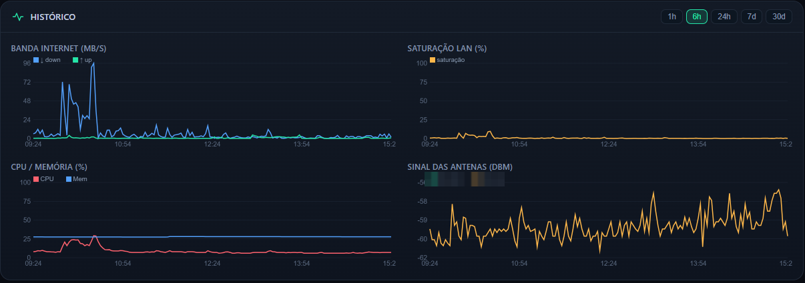
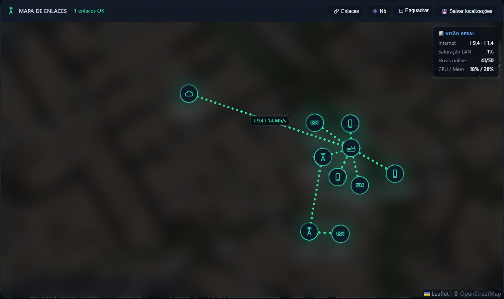
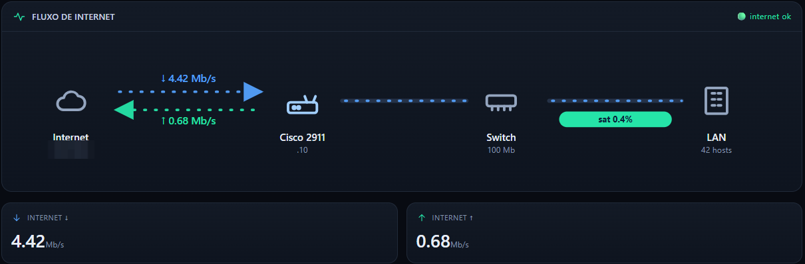
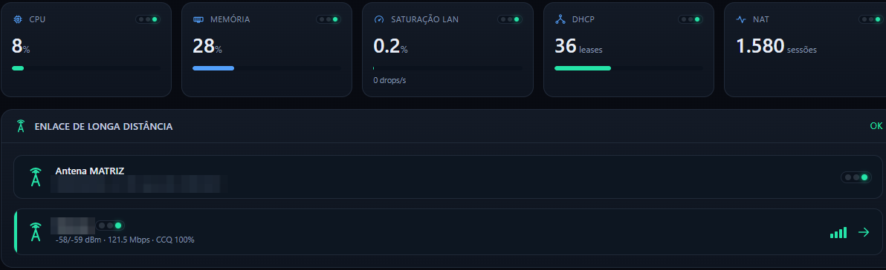

# NetMon Kit

**Monitoramento de rede para pequena empresa, feito pra quem é dono, não pra equipe de TI.**

O servidor Windows que a empresa já tem vira o centro de vigilância da rede: roteador, internet,
Wi-Fi, câmeras, estações e a VPS do sistema de vendas. Tudo aparece num painel web e o NetMon
**avisa no Telegram, em português, só quando importa**.

> Status: **v0.3, alfa.** Nasceu e roda há meses numa empresa real (~30 equipamentos, 1 servidor
> Windows, roteador Cisco, 3 APs, DVRs, 10 estações, sistema de vendas numa VPS). Funciona, mas foi
> moldado para aquele cenário. Ajuste para o seu e conte o que quebrou.

Licença **MIT**: use, adapte e venda serviço em cima à vontade; só mantenha o aviso de autoria.

## Como fica





<p>
  
  
</p>

<sub>Prints da instalação piloto, com nomes, endereços e a localização removidos.</sub>

---

## O que ele vigia

| Módulo | O que faz | Arquivos |
|---|---|---|
| **Painel NetMon** | Painel web (PC e celular, instalável como app): roteador (CPU, memória, saturação, erros CRC da WAN), internet, enlaces de rádio (SNMP), mapa da rede, DVRs, estações, histórico. Motor de alertas e bot do Telegram com comandos. | `1-nucleo/netmon.py` + `*.html` |
| **DNS interno** | Encaminhador DNS leve no servidor + log de consultas, que denuncia máquina em laço de DNS/WPAD. | `1-nucleo/dns.py`, `dnslog.html` |
| **HTTPS por nome** | Caddy na frente do painel (`https://noc`). | `1-nucleo/Caddyfile` |
| **Câmeras** | Mural dos DVRs via [go2rtc](https://github.com/AlexxIT/go2rtc), substream e usuário só-leitura. | `cameras.html`, `0-modelos/go2rtc.example.yaml` |
| **Vigia da VPS** | SSH testado a cada 15 s, janela de 5 min; avisa quando cai e quando volta; não culpa a VPS quando quem caiu foi a internet da empresa; conta os túneis do sistema de vendas pelo NAT. | `2-vigias/vps_monitor.py` |
| **Sondas de internet** | Saída nacional e internacional contínua + erros CRC da WAN. Separa "a operadora caiu" de "o nosso cabo ou modem". | `sonda_wan2.ps1`, `medir_wan.ps1` |
| **Wi-Fi** | Ping nos APs, log remoto (syslog) guardado 90 dias e alerta de **reinício** pelo uptime via SNMP. | `vigia_aps.ps1`, `syslog_rx.py`, `snmp_aps.py` |
| **Estações Windows** | Disco, temperatura, firewall, antivírus, energia e laço de DNS de cada PC, por WinRM, com credenciais em cofre DPAPI. | `3-estacoes/*` |
| **Kit pendrive** | Para PC ainda não gerenciado: `ABRE-GERENCIA` (admin local + WinRM) e `MATA-ZUMBI` (laço de DNS/WPAD). | `4-pendrive/*` |
| **Ferramentas** | Wake-on-LAN, comandos no Cisco, varredura da LAN, topologia. | `5-ferramentas/*` |

---

## Requisitos

- **Servidor Windows** ligado 24 h (Server 2016+ ou Windows 10/11 Pro), ~2 GB de RAM livre.
- **Python 3** (o embeddable numa pasta `python\` ao lado dos scripts basta) e o `cacert.pem`
  (o Windows Server 2016 não fecha TLS moderno sozinho).
- **Bot do Telegram** (@BotFather) e o `chat_id` de quem recebe os avisos.
- **plink.exe** (PuTTY) se o roteador for Cisco/SSH.
- Acesso de administrador às estações (WinRM) ou o pendrive `ABRE-GERENCIA`.
- **SNMP só-leitura** nos rádios e APs, com community própria e restrita ao IP do servidor.

---

## Instalação rápida

**Com um agente de IA (recomendado).** Baixe o kit no servidor, abra o Claude Code, o Codex ou outro
agente de código na pasta e peça: *"instala o NetMon nesta rede"*. O [`AGENTS.md`](AGENTS.md) ensina o
agente a descobrir a rede, entrevistar você, montar o `config.json` e rodar o instalador, com regras
de segurança (senha nunca passa pelo chat, nada muda na rede sem o seu OK).

**Pelo instalador.** Preencha `C:\netmon\config.json` a partir de `0-modelos\config.example.json` e, num
PowerShell **como administrador**, na pasta do kit:

```powershell
.\INSTALAR.ps1 -Simular   # mostra o que faria, sem mudar nada
.\INSTALAR.ps1            # testa o Telegram, cria tarefas e firewall, sobe tudo
.\INSTALAR.ps1 -Remover   # desfaz (tarefas e firewall; arquivos ficam)
```

Os módulos ligam sozinhos conforme o que existir: sem roteador Cisco, sem DVR ou sem VPS, o que
depende deles fica de fora.

## Instalação manual (o que o instalador faz por baixo)

1. **Levantamento** da rede (checklist abaixo).
2. Copie o conteúdo das pastas `1-` a `5-` para `C:\netmon\` no servidor, junto com `python\`,
   `cacert.pem` e `plink.exe`.
3. Copie `0-modelos/config.example.json` para `C:\netmon\config.json` e preencha. **Tudo que é da rede
   do cliente fica no config**: nome da empresa (`site_name`), IPs (`rede`), roteador (`cisco`),
   VPS (`vps`), lista de APs (`aps`), Telegram, regras de alerta.
   Faça o mesmo com `dns.example.json`, `go2rtc.example.yaml` e `aps-snmp.example.json`.
4. **Pendrive:** no `ABRE-GERENCIA.ps1`, ajuste `-Rede`, `-Relay` e `$SEGREDO_RELAY`
   (o mesmo valor de `alerts.entrega_segredo`). É o único script que roda fora do servidor e por isso
   não lê o config.
5. Crie as tarefas agendadas como **SYSTEM**, **na inicialização**, **sem limite de tempo (`PT0S`)** e com
   reinício automático: `NetMon`, `NetMon-DNS`, `NetMon-Caddy`, `NetMon-Cameras`, `NetMon-Watchdog`,
   `TI-VigiaVPS`, `TI-SondaWAN2`, `TI-MedirWAN`, `TI-VigiaAPs`, `TI-Syslog`.
6. **Teste o Telegram antes de ligar os vigias** (`INSTALAR-VIGIA-VPS.ps1` é o modelo: se a mensagem
   de teste não chega, ele não instala).
7. Estações: pendrive onde não há WinRM, depois `importar-credenciais.ps1` (cofre) e `estacoes.ps1`.
8. Firewall do servidor: libere só painel, DNS e syslog (UDP 514) vindos da rede local.
9. Na primeira semana, ajuste os limites (CRC, CPU, latência) pelo que é normal **naquela** rede.

> **Nunca** mande senha por chat ou e-mail para quem está instalando: o dono digita direto no servidor.

---

## Política de alertas (anti-ruído)

- **Problema novo sai na hora**, sempre. A volta ao normal também.
- **Problema que continua** repete só em horários fixos (`repeat_hours`, padrão 12 h e 18 h).
- **Confirmação:** só dispara depois de N leituras ruins seguidas (`confirm`, padrão 3).
- **Silenciar** (`mute`) tira do Telegram mas mantém no histórico.
- **Rotina diária** só fala quando dá errado.

No piloto isso levou de **137 para 23 mensagens por dia**.

---

## Levantamento por cliente

- [ ] Faixa de IP, gateway, quem entrega DHCP, reservas, DNS
- [ ] Roteador/firewall: modelo, acesso SSH/SNMP, log e NTP ligados
- [ ] Internet: operadora, modem e IP do modem
- [ ] Wi-Fi: APs, controladora (ou não), redes e quem usa qual
- [ ] Enlaces de rádio entre prédios
- [ ] Servidores, VPS e o sistema que para a venda se cair
- [ ] Estações: nome, usuário, Windows Home ou Pro, notebook ou desktop
- [ ] DVRs, impressoras, PDVs, balanças
- [ ] Energia: o que tem nobreak e o que divide tomada
- [ ] Quem recebe os alertas e em que horário

---

## Lições do piloto (cada uma custou caro)

1. **O `ping` do Windows mente no código de saída:** "Host de destino inacessível" sai como sucesso. Só vale `TTL=` na resposta.
2. **PowerShell não diferencia maiúscula:** `$INTL` e `$intl` são a mesma variável; `-replace` também ignora caixa.
3. **Tarefa agendada morre em 72 h** se o limite de execução não for `PT0S`.
4. **JSON com BOM quebra o Python.** Grave UTF-8 sem BOM; leia com `utf-8-sig`.
5. **Server 2016 não fala TLS moderno pelo PowerShell:** Telegram e afins vão por Python + `cacert.pem`.
6. **Nunca desative o serviço `WinHttpAutoProxySvc`:** o Wi-Fi do Windows depende dele. Para matar WPAD basta a política `DisableWpad=1`.
7. **Erro engolido em silêncio esconde o problema:** todo vigia grava falha em log e sai com erro.
8. **Ping e ARP não provam que o PC está fora** (firewall bloqueia ICMP; ARP envelhece). O teste honesto é abrir a sessão WinRM.
9. **Tarefa como SYSTEM não enxerga a host key do PuTTY** do usuário: copie para o perfil do SYSTEM.
10. **API que responde "sucesso" não prova que gravou** (controladora Omada). Releia depois de escrever.
11. **APs EAP225 que travavam na volta da energia** ficaram estáveis resetados, fora da controladora e com IP fixo. No modo stand-alone: SSID é por faixa (crie 2x), não há "RSSI mínimo" e o nome do AP vai no SysName do SNMP.
12. **O syslog dos APs manda a navegação de cada cliente** a cada 5 s (~150 MB/dia, e é dado pessoal): o receptor descarta e só conta.
13. **Impressora automática (WSD/IPP) em notebook** fica presa à placa de rede em que foi criada (`fe80::…%N`): trocou cabo por Wi-Fi, parou de imprimir.
14. **Status que esconde repetição esconde problema aberto:** liste sempre o que está "em aberto agora".
15. **Não mexa na rede da máquina que o dono está usando** (IP extra, serviço de rede) sem perguntar.
16. **Equipamentos que dividem tomada caem juntos** (AP + DVR): o alerta de um ajuda a diagnosticar o outro.
17. **Depois que a VPS reinicia, o sistema de vendas pode não reconectar sozinho:** o aviso de volta já diz "feche e abra".

---

## Segurança

- **Nada de segredo no repositório.** `config.json`, `dns.json`, `aps-snmp.json`, `go2rtc.yaml`, cofres,
  bancos e logs estão no `.gitignore`. Só os `*.example.*` sobem.
- Ative **Secret scanning** e **Push protection** nas configurações do seu fork.
- Credenciais das estações ficam em cofre DPAPI (`importar-credenciais.ps1`): só a conta e a máquina
  que gravaram conseguem ler.
- O painel escuta na LAN. Não exponha a porta 8787 para a internet.

---

## Roadmap

- [x] Tudo que é do cliente no `config.json` (v0.2)
- [x] `INSTALAR.ps1` único: pastas, tarefas, firewall e teste do Telegram (v0.3)
- [x] Instalação guiada por agente de IA: `AGENTS.md` (v0.3)
- [ ] Assistente de primeiro uso: varre a LAN e sugere nomes pelo fabricante
- [ ] Módulos liga/desliga (sem Cisco, sem DVR, sem controladora...)
- [ ] Outros roteadores: MikroTik, pfSense, roteador da operadora via SNMP
- [ ] Painel que reúne vários clientes e atualização remota
- [ ] Textos em inglês

## Contribuindo

Issues e pull requests são bem-vindos, principalmente: suporte a outros roteadores, outras marcas de
AP/DVR e relatos de instalação ("instalei em tal cenário e quebrou aqui"). Antes de abrir um PR,
confira que não vai nenhum IP, nome ou senha da sua rede.

## Licença

[MIT](LICENSE).
